# Metrocraft 2036 website and player services

The web side of [Metrocraft 2036](https://github.com/IgorJs2/MetrocraftGame): the game website in two editions, the IGS ID account system, player profiles, payments, the forum, the support desk and the launcher.

[metrocraft36.com](https://metrocraft36.com) (global) · [metrocraft36.ru](https://metrocraft36.ru) (Russian) · [forum.igsteam.com](https://forum.igsteam.com) · [support.igsteam.com](https://support.igsteam.com) · [YouTube](https://www.youtube.com/@metrocraft36)

> Source code is private (Interactive Game Studio). This repository describes the project and my role.

| | |
|---|---|
| My role | Project Lead / CTO of Metrocraft 2036, Apr 2024 – Sep 2026. I designed this system, wrote much of the backend and ran its servers |
| Current version | Went live in October 2026, after a maintenance window that replaced the site, forum, login and launcher at once |
| Editions | Global (.com, English) and Russian (.ru): separate domains, news, forum sections and file servers, one shared account |

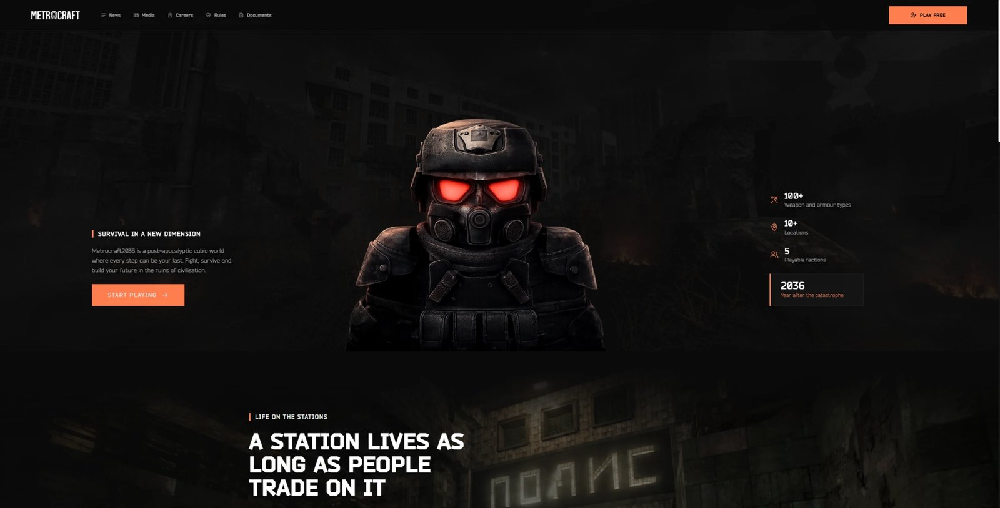

## How it fits together
- Next.js frontend, one codebase built into two editions by domain.
- The backend started as a NestJS app. I later split it into seven Java/Spring Boot services behind a gateway.
- IGS ID, one account for everything, runs on Keycloak. A player signs in once and the site, forum, support desk and launcher all know who they are. It supports Discord, Google, Twitch and Telegram linking and two-factor login.
- Payments through PayPal, YooMoney, Enot and UnitPay.
- Images and downloads come from the nearest file server, in Russia or in Europe.
- Docker Compose environments with GitHub Actions deploys, behind nginx and Cloudflare, with Sentry, Prometheus and Grafana for errors and metrics.

## IGS ID and the player profile
The profile has five tabs: account info (nickname, playtime, balance, characters, promo codes), linked accounts, an inventory of event rewards and currency, recent activity across the site, forum and launcher, and security settings with 2FA.

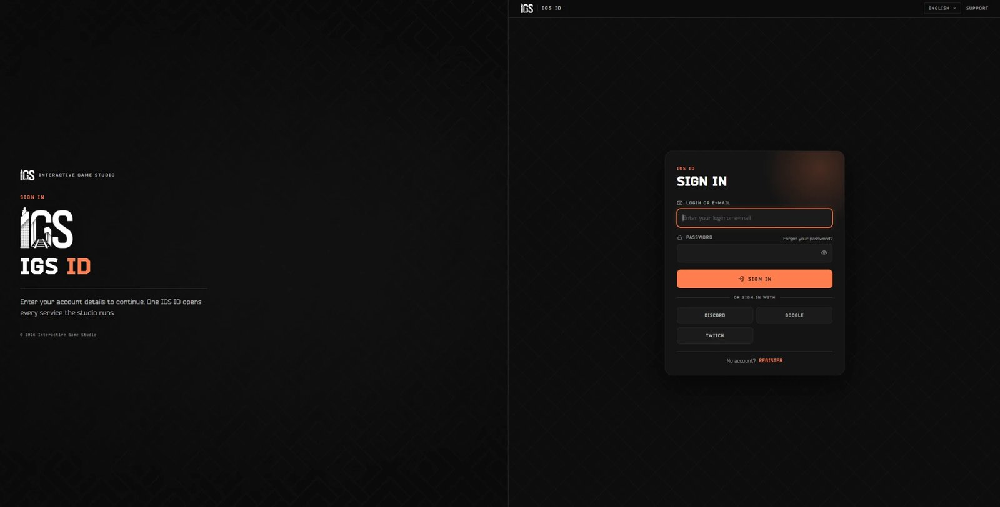
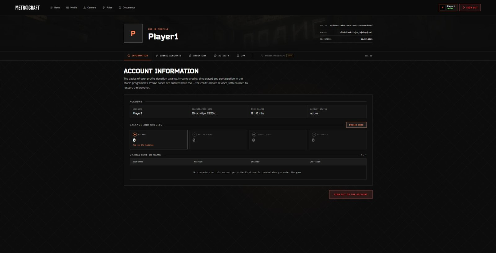
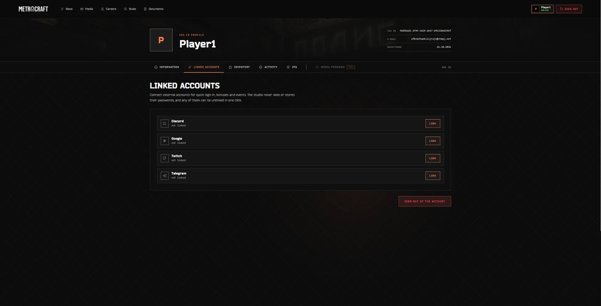
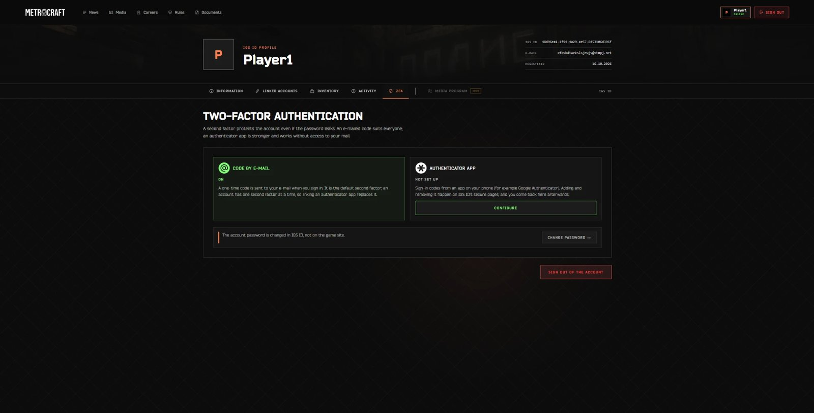
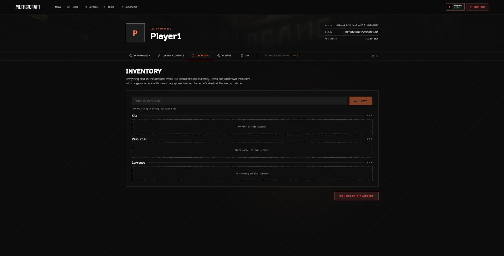
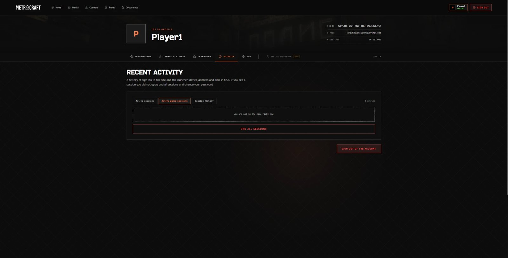

## News, forum and support
- News with categories (updates, patch notes, tests, devlogs), shown on the site and inside the launcher.
- A Flarum forum signed in through IGS ID.
- A FreeScout support desk with a knowledge base and auto-replies, linked to Jira so bug reports turn into tickets.
- An admin panel for players, punishments, mailings, game tables, the auction and job applications.

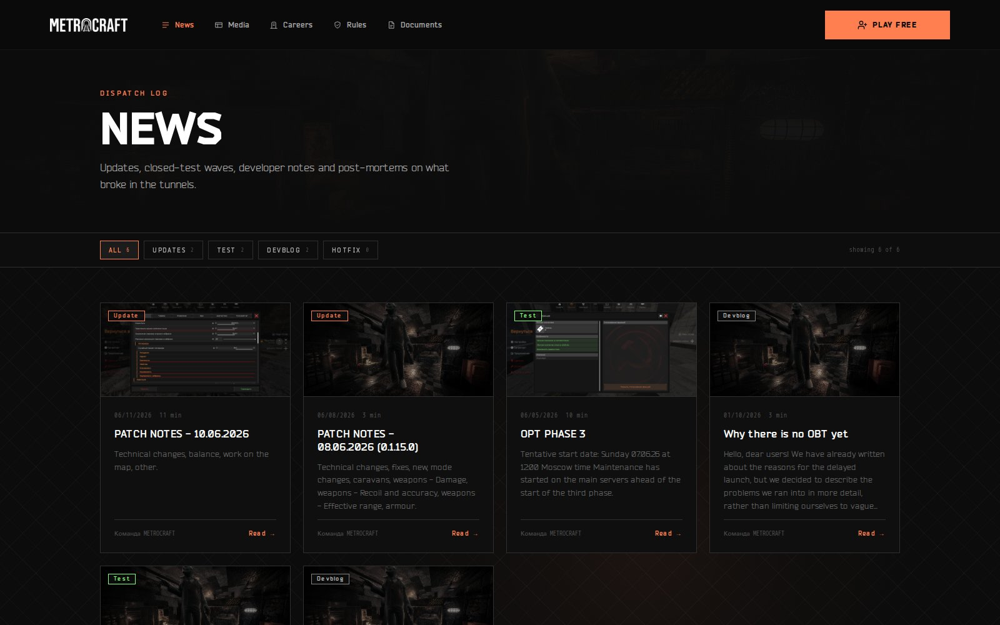
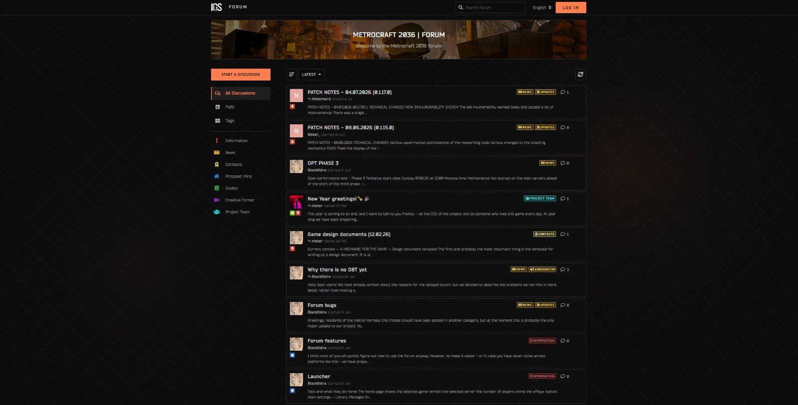
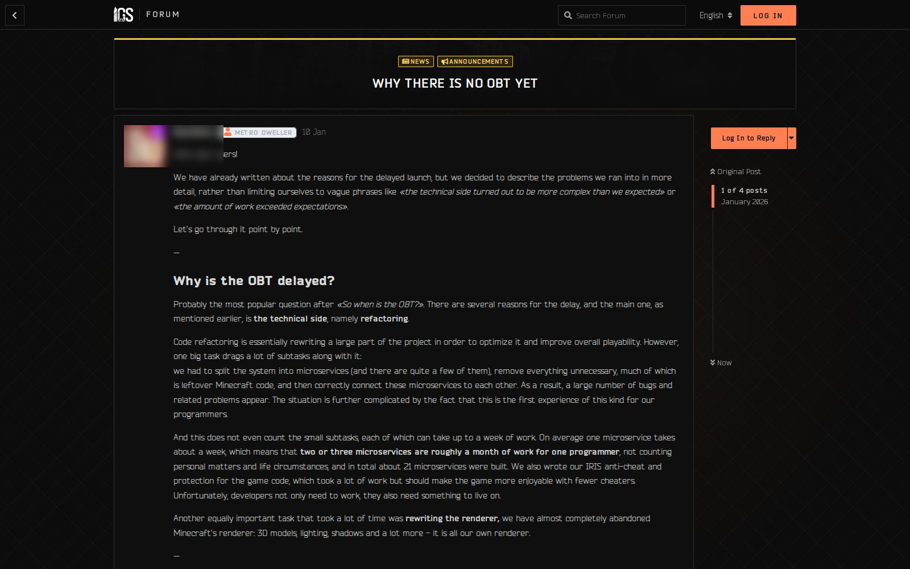
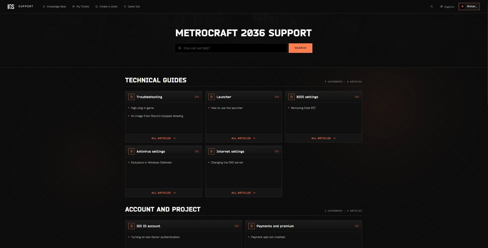

## Launcher
A Tauri launcher with versioned builds, several saved accounts, a language switch, news, 2FA and telemetry. The client is delivered over S3/CDN and peer-to-peer, with seed nodes on rqbit.

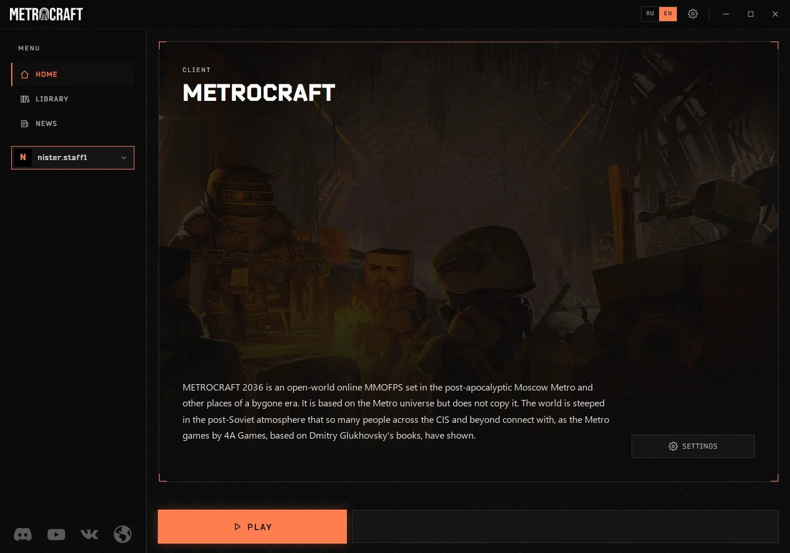
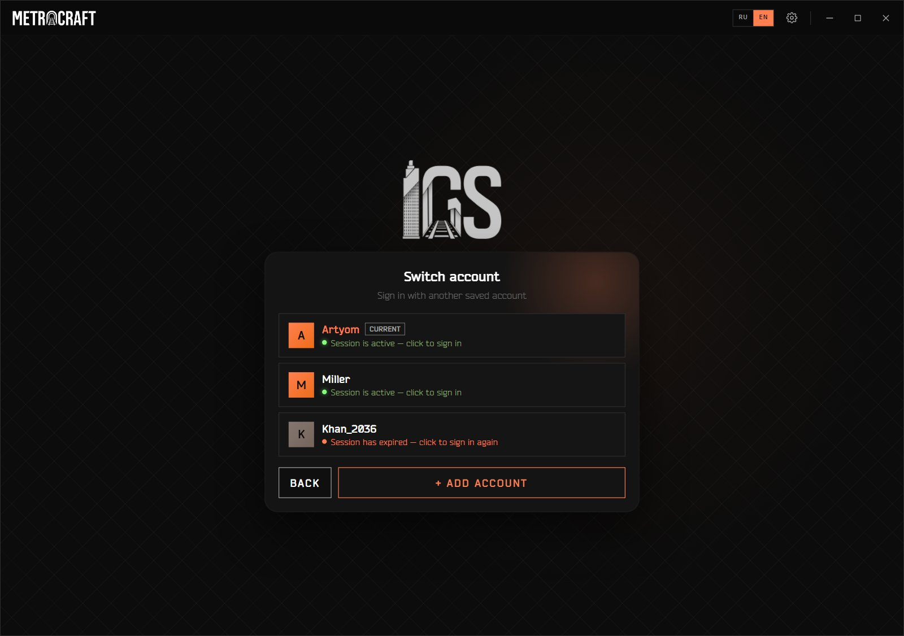
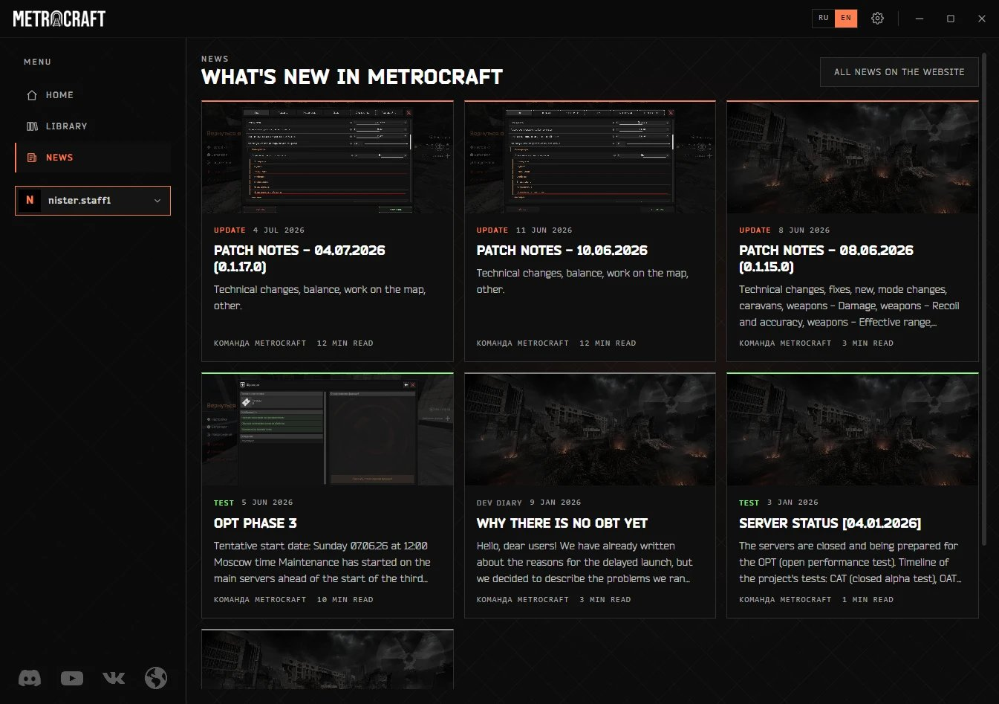
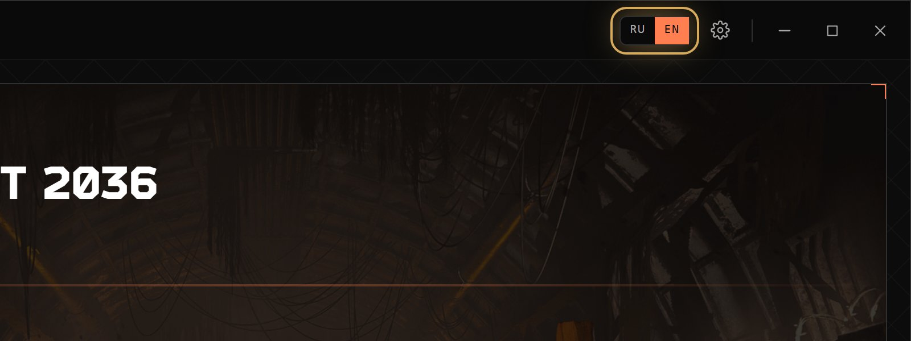

## Tech stack
| Area | Stack |
|---|---|
| Frontend | Next.js, React, TypeScript |
| Backend | Java, Spring Boot; earlier Node.js, NestJS and TypeORM |
| Auth | Keycloak (IGS ID), Discord, Google, Twitch and Telegram linking, 2FA |
| Community | Flarum, FreeScout, Discord bots |
| Launcher | Tauri, S3/CDN, peer-to-peer delivery (rqbit) |
| Infrastructure | Docker Compose, GitHub Actions, nginx, Cloudflare, Sentry, Prometheus, Grafana |
